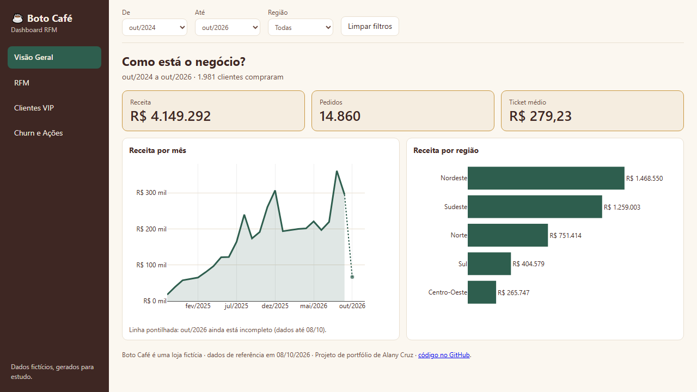
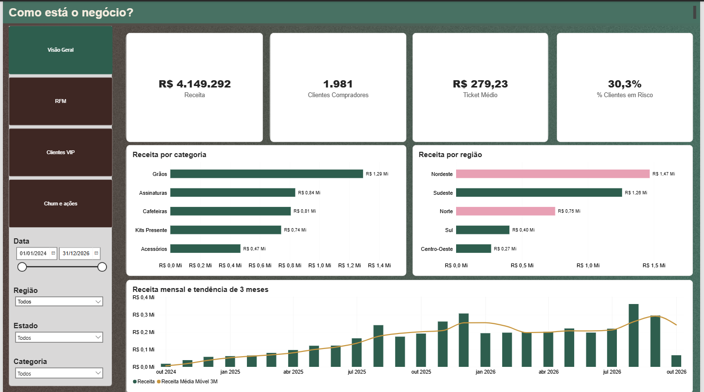
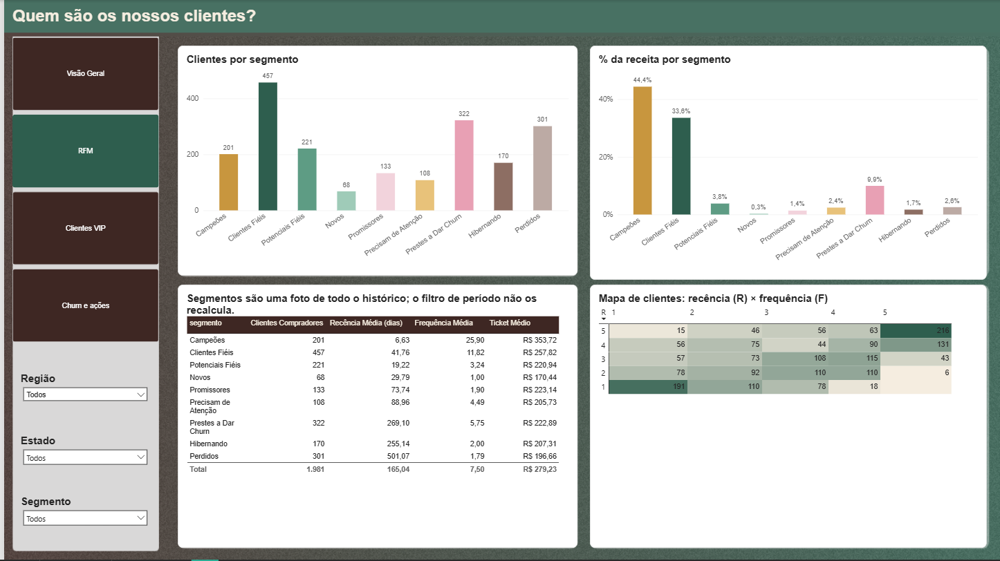
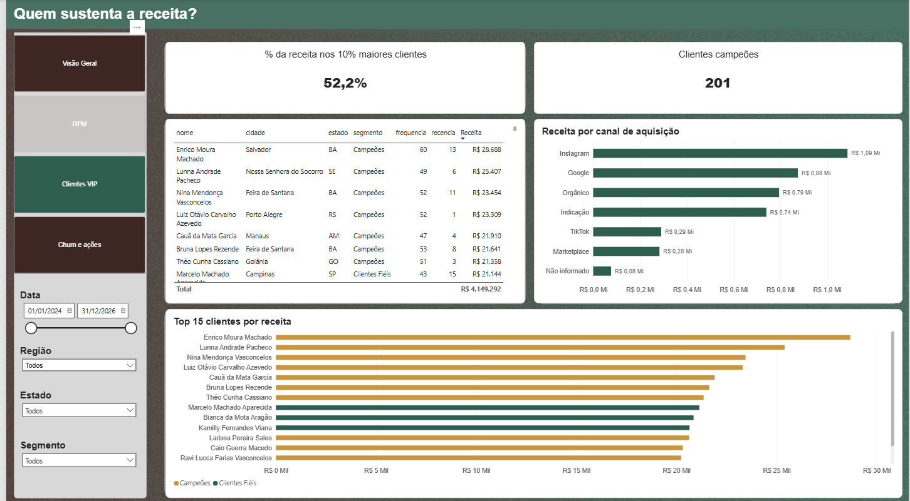
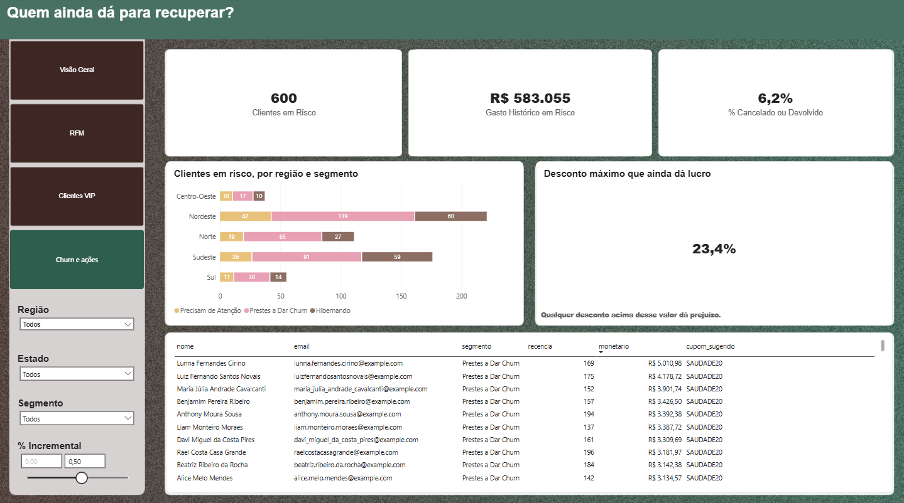

# ☕ Boto Café · Segmentação de clientes com RFM

[](https://github.com/lanybcr/boto-cafe/actions/workflows/ci.yml)


Projeto de portfólio de **Analytics Engineering**: do banco de dados até o dashboard, passando por análise RFM
(em Python **e em SQL**), estratégia de cupons com conta de lucro e testes automáticos.

> **Os dados são fictícios.** O Boto Café é uma loja de cafés especiais inventada. Os padrões foram gerados para
> demonstrar o método e não representam um negócio real.

[](https://lanybcr.github.io/boto-cafe/dashboard/)

**▶ [Abrir o dashboard interativo](https://lanybcr.github.io/boto-cafe/dashboard/)** (direto no navegador, funciona no celular) ·
[Painel no Power BI](#painel-no-power-bi) · [Dicionário de dados](docs/dicionario_de_dados.md)

## O problema e a resposta

*Quem vale investir, quem está sumindo e quanto podemos gastar para trazer essas pessoas de volta?*

1. **Receita concentrada:** Campeões e Clientes Fiéis geram **78% da receita**; os 10% maiores clientes, **52%**.
2. **Dinheiro parado:** **600 clientes (30%) estão em risco** e já gastaram **R$ 583 mil**.
3. **Cupom com conta:** só compensa se `desconto < incremental × margem`. Com as premissas do projeto, uma
   campanha por segmento rende cerca de **R$ 14 mil de lucro líquido** (ROI 1,2). Os melhores retornos
   (≈ 1,7 por real gasto) estão em Novos, Promissores, Precisam de Atenção e Hibernando.

Base: R$ 4,15 milhões de receita, 14.860 pedidos, 1.981 clientes compradores, ticket médio de R$ 279.

## O que eu entrego

Se você tem uma base de clientes e pedidos, este projeto mostra o que eu faço com ela:

| Etapa | Entrega | Onde ver |
|---|---|---|
| **Dados** | Banco organizado, limpeza das inconsistências e validação de integridade | `src/`, `docs/` |
| **Análise** | RFM com 9 segmentos, em Python **e em SQL** (views), com resultado idêntico conferido por teste | `src/rfm.py`, `sql/` |
| **Ação** | Campanha por segmento com simulação de lucro e lista de clientes pronta para o marketing | `src/cupons.py`, `data/campanhas/` |
| **Dashboards** | O mesmo painel em **HTML**, **Streamlit** e **Power BI** (modelo estrela, medidas DAX) | `dashboard/`, `app/`, `powerbi/` |
| **Confiança** | 16 testes automáticos e CI que refaz tudo do zero a cada alteração | `tests/`, `.github/` |

## Painel no Power BI

Arquivo `powerbi/boto-cafe.pbix`: quatro páginas, uma pergunta por página.

| Página | Pergunta | Captura |
|---|---|---|
| Visão Geral | Como está o negócio? |  |
| RFM | Quem são os nossos clientes? |  |
| Clientes VIP | Quem sustenta a receita? |  |
| Churn e Ações | Quem ainda dá para recuperar? |  |

## Como o RFM funciona

| Letra | Mede | Como calculamos |
|---|---|---|
| **R**ecência | Há quanto tempo comprou | Dias desde a última compra válida |
| **F**requência | Quantas vezes comprou | Número de pedidos válidos |
| **M**onetário | Quanto gastou | Soma do valor pago, já com desconto |

Cada métrica vira uma nota de 1 a 5 (quintis) e a combinação cai em um de 9 segmentos, de Campeões a Perdidos.
Só contam pedidos pagos, enviados ou entregues; cancelados, devolvidos e pendentes ficam de fora.

## Decisões que fazem diferença

- **Cupom só compensa se `desconto < incremental × margem`.** Campeões ganham brinde em vez de desconto, porque já
  comprariam de qualquer forma.
- **Margem calculada do custo real dos produtos**, não chutada.
- **A análise nunca vê o gabarito.** O gerador grava os perfis "verdadeiros" em arquivo separado, só para conferir se
  a segmentação encontra o que foi plantado.
- **Mesmos números nos três dashboards** (R$ 4.149.292, 1.981 compradores, 30,3% em risco), inclusive ao filtrar por estado.
- **Modelo estrela no Power BI**, com medidas DAX documentadas.

## Limitações

- **Dados fictícios:** a conclusão serve para mostrar o método, não para decidir um negócio real.
- **Taxas de resposta e % incremental dos cupons são hipóteses** (`PREMISSAS` em `src/cupons.py`). O lucro da simulação
  depende delas; em um caso real, um teste A/B é o que confirma.
- **Base de cerca de 2 anos:** comparação ano contra ano só vale a partir do 13º mês.
- **Cliente em risco é um sinal para agir**, não um cliente perdido.

## Rodar o projeto

Requer Python 3.12.

```bash
python -m venv .venv
.venv/Scripts/pip install -r requirements-dev.txt     # Linux/macOS: .venv/bin
.venv/Scripts/python -m src.gerar_dados               # gera o banco e as views SQL
.venv/Scripts/python -m pytest                        # roda os testes
.venv/Scripts/streamlit run app/streamlit_app.py      # dashboard Streamlit
```

A geração é determinística (`SEED = 42`): rodar de novo produz os mesmos dados.

## Autoria e licença

Projeto de **Alany Cruz** · [GitHub](https://github.com/lanybcr). Código sob licença [MIT](LICENSE).

**Python · pandas · SQL (views, funções de janela) · Power BI (DAX) · Plotly · Streamlit · pytest · GitHub Actions**
